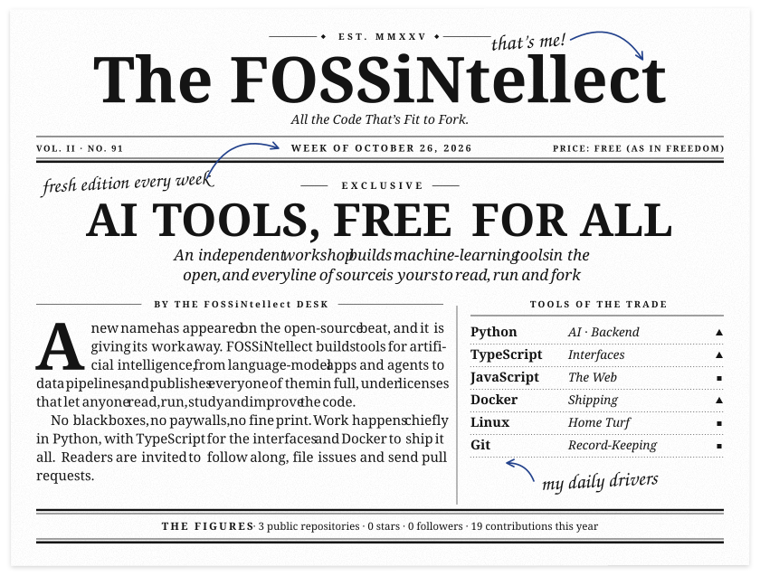
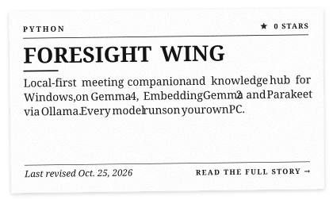
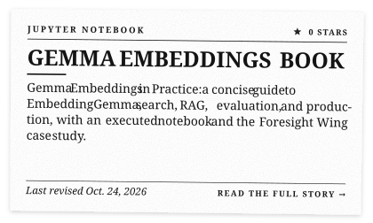
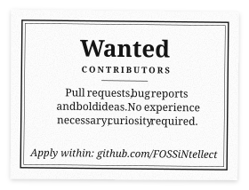

<!-- Printed by press/press.py. Edit newsroom.toml, not this file: the presses overwrite it. -->

<picture><source media="(prefers-color-scheme: dark)" srcset="assets/dark/front-page.svg"></picture>

<picture><source media="(prefers-color-scheme: dark)" srcset="assets/dark/section-print.svg"></picture>

<a href="https://github.com/FOSSiNtellect/foresight-wing"><picture><source media="(prefers-color-scheme: dark)" srcset="assets/dark/print-1.svg"></picture></a>
<a href="https://github.com/FOSSiNtellect/gemma-embeddings-book"><picture><source media="(prefers-color-scheme: dark)" srcset="assets/dark/print-2.svg"></picture></a>

<picture><source media="(prefers-color-scheme: dark)" srcset="assets/dark/section-classifieds.svg"></picture>

<a href="https://github.com/FOSSiNtellect?tab=repositories"><picture><source media="(prefers-color-scheme: dark)" srcset="assets/dark/ad-contributors.svg"></picture></a>
<a href="https://github.com/FOSSiNtellect"><picture><source media="(prefers-color-scheme: dark)" srcset="assets/dark/ad-subscribe.svg"></picture></a>

<picture><source media="(prefers-color-scheme: dark)" srcset="assets/dark/colophon.svg"></picture>

<b>Read the plain-text edition</b> (for screen readers, small screens and search engines)

### The FOSSiNtellect
*All the Code That’s Fit to Fork.* · Vol. II, No. 91 · Week of October 26, 2026

#### AI TOOLS, FREE FOR ALL
*An independent workshop builds machine-learning tools in the open, and every line of source is yours to read, run and fork.*

**BY THE FOSSiNtellect DESK**

A new name has appeared on the open-source beat, and it is giving its work away. FOSSiNtellect builds tools for artificial intelligence, from language-model apps and agents to data pipelines, and publishes every one of them in full, under licenses that let anyone read, run, study and improve the code.

No black boxes, no paywalls, no fine print. Work happens chiefly in Python, with TypeScript for the interfaces and Docker to ship it all. Readers are invited to follow along, file issues and send pull requests.

**Tools of the trade:** Python (AI · Backend) · TypeScript (Interfaces) · JavaScript (The Web) · Docker (Shipping) · Linux (Home Turf) · Git (Record-Keeping)

**The figures, Oct. 26, 2026:** 3 public repositories · 0 stars · 0 followers · 19 contributions in the past year

**Now in print:**

- [foresight-wing](https://github.com/FOSSiNtellect/foresight-wing): Local-first meeting companion and knowledge hub for Windows, on Gemma 4, EmbeddingGemma 2 and Parakeet via Ollama. Every model runs on your own PC.
- [gemma-embeddings-book](https://github.com/FOSSiNtellect/gemma-embeddings-book): Gemma Embeddings in Practice: a concise guide to EmbeddingGemma, search, RAG, evaluation, and production, with an executed notebook and the Foresight Wing case study.

**Classifieds:** [Wanted contributors](https://github.com/FOSSiNtellect?tab=repositories) · [Subscribe today · free forever](https://github.com/FOSSiNtellect)

